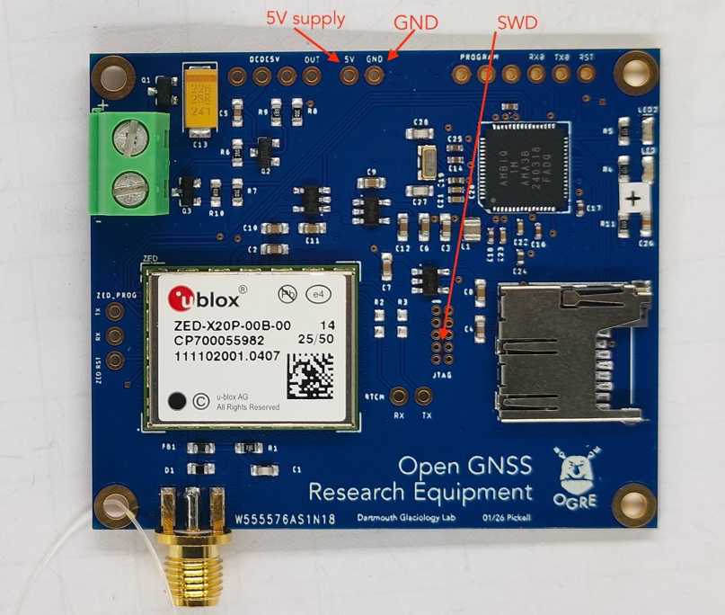

# OGRE Firmware Upload Guide

How to load firmware onto an OGRE, either over USB-to-Serial (boards with the SparkFun bootloader) or over SWD/JTAG with a SEGGER J-Link (boards without it, including newly manufactured OGREv2 boards).

Only do this if you want to update the firmware on the OGRE, or if the OGRE has not yet had the firmware installed. Pre-compiled binary files are available with each release (see [releases](https://github.com/glaciology/OGRE/releases/)). For everything else (configuration, LEDs, deployment), see the [OGRE User Guide](OGRE_User_Guide.md).

---

## Contents

- [Step 0: Choose the upload method and binary](#step-0-choose-the-upload-method-and-binary)
- [Option A: Upload over USB-to-Serial (SVL)](#option-a-upload-over-usb-to-serial-svl)
- [Option B: Upload over SWD with a J-Link](#option-b-upload-over-swd-with-a-j-link)
- [Installing the SparkFun bootloader on an OGREv2](#installing-the-sparkfun-bootloader-on-an-ogrev2)
- [Troubleshooting](#troubleshooting)
- [Note: start addresses 0xC000 and 0x10000](#note-start-addresses-0xc000-and-0x10000)

---

## Step 0: Choose the upload method and binary

Binaries differ by hardware version and by start address. Use the binary that matches both your board and its bootloader:

| Board | Bootloader on MCU | Binary start address | Upload method |
|---|---|---|---|
| OGREv1 (Artemis module, 1 LED) | SparkFun Variable Loader (SVL), installed on Artemis modules | 0x10000 | [Option A](#option-a-upload-over-usb-to-serial-svl): USB-to-Serial, `svl.py` |
| OGREv2 (Apollo3, 2 LEDs), newly manufactured - PCBWay START HERE | None (Ambiq secure bootloader only) | 0xC000 | [Option B](#option-b-upload-over-swd-with-a-j-link): SWD/JTAG |
| OGREv2 (Apollo3, 2 LEDs) | SVL installed | 0x10000 | [Option A](#option-a-upload-over-usb-to-serial-svl): USB-to-Serial, `svl.py` |

- A newly manufactured OGREv2 can only be programmed over SWD/JTAG.
- A 0x10000 binary does not run on an MCU without the SVL.
- Writing a 0xC000 binary over SWD/JTAG overwrites the SVL. Subsequent uploads require SWD/JTAG, unless the SVL is installed again.
- A v1 binary on a v2 board (or a v2 binary on a v1 board) uses the wrong pin assignments; the instrument does not operate.

If you compile the firmware yourself, set `HARDWARE_VERSION` in OGRE.ino (`1` = OGREv1, `2` = OGREv2) and build for the start address that matches the target bootloader. See Firmware modification in the [OGRE User Guide](OGRE_User_Guide.md#firmware-modification).

---

## Option A: Upload over USB-to-Serial (SVL)

For OGREv1 boards, and OGREv2 boards with the SVL installed. Uses the [SparkFun Apollo3 Uploader](https://github.com/sparkfun/Apollo3_Uploader_SVL) (`svl.py`).

**You will need:**

- Your OGRE and a DC power source (6-20 V) for the power terminal
- A **3.3 V** USB-to-Serial converter. **DO NOT EXPOSE pins to 5V.**
- Python 3 and `svl.py` from the SparkFun Apollo3 Uploader
- The firmware file for your board, built for address `0x10000`

**Steps:**

1. Apply power to the OGRE power terminal with a DC source (6-20 V).
2. Connect the USB-to-Serial converter to the OGRE serial header pins: Ground to GND, converter RX -> OGRE TX, converter TX -> OGRE RX. On OGREv1 this is the 5 through-hole pin header. On OGREv2 the serial pins are on the PROGRAM header (labeled RX0, TX0, RST; see the photo in Option B).
3. Find the serial port of the converter: type `ls /dev/tty.*` (macOS/Linux) and select the USB serial port (e.g., `/dev/tty.usbserial-####`). On Windows, the port is a `COM` port, shown in Device Manager.
4. Run `svl.py` at 115200 baud with the path to the binary file and the port:

   ```
   python3 svl.py -b 115200 -f /PATH/TO/BINARY/FILE/OGRE.ino.bin /dev/tty.usbserial-####
   ```

5. After the upload, the OGRE starts the new firmware. With the antenna connected and a view of the sky, the LED blinks at 1 Hz while the OGRE syncs its clock (up to 3 minutes), then blinks 10 times when setup is complete.

---

## Option B: Upload over SWD with a J-Link

For newly manufactured OGREv2 boards, and any board without the SVL. A step-by-step guide for first-time users. By the end you will have installed the SEGGER tools and loaded the firmware onto your OGRE.

**Time needed:** about 15 minutes, most of it installing.

**You will need:**

- Your OGRE
- A J-Link EDU Mini V2 debugger and a USB cable
- The 2x5 ribbon cable that connects the debugger to the OGRE
- A power source for the OGRE: 5 V on the 5V header pin (with GND), or a DC source (6-20 V) on the power terminal
- The firmware file for OGREv2 (e.g., `OGRE2.ino.bin`), built for address `0xC000` (see the [note at the end](#note-start-addresses-0xc000-and-0x10000))
- A Mac with Terminal (Windows and Linux notes are in Step 1)

**Words you will see:**

| Term | Meaning |
| --- | --- |
| SWD | The debug connection the debugger uses to talk to the OGRE's chip |
| J-Link Commander (`JLinkExe`) | SEGGER's command-line program for talking to the debugger |
| `.bin` | A raw firmware file |
| `0xC000` | The memory address where the firmware gets written |



OGREv2 programming connections: 5V supply and GND pins (top header) and the 2x5 SWD header (labeled JTAG, next to the microSD slot).

### Step 1: Install the SEGGER tools

**On macOS:**

1. Go to [https://www.segger.com/downloads/jlink/](https://www.segger.com/downloads/jlink/).
2. Download **J-Link Software and Documentation Pack for macOS**.
3. Open the downloaded `.pkg` file and click through the installer.
4. Open **Terminal** (press Cmd+Space, type "Terminal", press Enter).
5. Type this and press Enter to check the install worked:

   ```
   JLinkExe
   ```
6. You should see a banner starting with `SEGGER J-Link Commander`. Type `exit` and press Enter to leave for now.

If Terminal says the command is not found, use the full path instead:

```
/Applications/SEGGER/JLink_V994/JLinkExe
```

The folder name matches the version you installed.

**On Windows:** download the Windows installer from the same page, run it, then start **J-Link Commander** from the Start menu.

**On Linux:** install the `.deb` or `.rpm` from the same page, then run `JLinkExe`.

### Step 2: Connect the debugger and power the OGRE

1. Plug the J-Link debugger into your computer with USB.
2. Plug the ribbon cable into the **SWD debug pins** on the OGRE. This is the 2x5 pin connector labeled JTAG (see the photo above).
3. **Align the red stripe of the ribbon cable with the silkscreen bar on the OGRE.** The red stripe marks pin 1, and the bar printed on the board shows where pin 1 is. If the cable is flipped, it will not connect.
4. Make sure the connector is pushed in fully.
5. **Power on the OGRE**: connect a 5 V source to the 5V pin and ground to the GND pin, or connect a DC source (6-20 V) to the power terminal. The debugger does not power it.

> **Do this before Step 3.** The debugger reads the OGRE's voltage when it starts. If the OGRE is off at that moment, you will see `VTref=0.000V` and the connection will not work.

### Step 3: Start J-Link Commander

In Terminal, type:

```
JLinkExe
```

Look at the last lines of the banner. You want to see:

```
Connecting to J-Link ...O.K.
...
VTref=3.3xxV
```

- **VTref around 3.3 V:** good, continue.
- **VTref=0.000V:** the OGRE is not powered or the cable is not seated correctly. Type `exit`, fix it, and start again.

### Step 4: Connect to the chip

At the `J-Link>` prompt, type `connect` and press Enter. Answer the questions like this:

| Prompt | What to type |
| --- | --- |
| Device> | `AMA3B1KK-KQR` |
| TIF> | `S` (for SWD) |
| Speed> | Just press Enter (uses 4000 kHz) |

(`AMA3B1KK-KQR` is the name of the chip inside the OGRE.)

If this works you will see lines like:

```
Found SW-DP with ID 0x2BA01477
...
Found Cortex-M4 r0p1, Little endian.
...
Cortex-M4 identified.
```

If it fails, see [Troubleshooting](#troubleshooting).

### Step 5: Upload the firmware

At the `J-Link>` prompt, type the command below, replacing the path with where your file really is:

```
loadBin /Users/YOUR-USERNAME/Desktop/OGRE2.ino.bin 0x0000C000
```

**Tip:** to avoid typos in the path, type `loadBin ` (with a space), then drag the file from Finder into the Terminal window. The path fills in for you. Then type ` 0x0000C000` after it.

Expected result:

```
Downloading file [/Users/YOUR-USERNAME/Desktop/OGRE2.ino.bin]...
J-Link: Flash download: Bank 0 @ 0x0000C000: 1 range affected (106496 bytes)
J-Link: Flash download: Program & Verify speed: ~150 KB/s
...
O.K.
```

- Lines saying `Secure Part` and `Bootloader needs to run` are normal for this chip. Ignore them.
- **Success** means you see `O.K.` and the range starts at `0x0000C000`.
- If you see `Failed to open file.`, the path is wrong. Check the folder name and spelling and try again.

**If the upload worked, the LEDs on the OGRE will start blinking.** With the antenna connected and a view of the sky, the yellow LED blinks at 1 Hz while the OGRE syncs its clock (up to 3 minutes), then blinks 10 times when setup is complete. See OGRE Indicator Lights in the [OGRE User Guide](OGRE_User_Guide.md#ogre-indicator-lights).

When you are done, type:

```
exit
```

### Quick reference

Once you are comfortable, the whole process is:

```
JLinkExe
connect
AMA3B1KK-KQR
S
(press Enter)
loadBin /Users/YOUR-USERNAME/Desktop/OGRE2.ino.bin 0x0000C000
exit
```

---

## Installing the SparkFun bootloader on an OGREv2

To enable serial programming on an OGREv2, follow Option B, but in Step 5 load the SparkFun bootloader file `svl.bin` instead of the OGRE firmware:

```
loadBin /PATH/TO/svl.bin 0x0000C000
```

`svl.bin` is available from SparkFun: [Apollo3_Uploader_SVL/bootloader/gcc/artemis_module/bin](https://github.com/sparkfun/Apollo3_Uploader_SVL/tree/main/bootloader/gcc/artemis_module/bin).

Afterwards, upload the OGREv2 firmware built for address `0x10000` using [Option A](#option-a-upload-over-usb-to-serial-svl). Any later Arduino build can then be uploaded over the serial interface instead of SWD.

---

## Troubleshooting

| What you see | What to try |
| --- | --- |
| `VTref=0.000V` | The OGRE is not powered, or the ribbon cable is not seated. Power the OGRE first, check the cable, then restart `JLinkExe`. |
| `Target voltage too low` | Check the OGRE's power supply and the cable connection, then retry. |
| `Failed to attach to CPU. Trying connect under reset.` then an error | Check the cable is pushed in fully and the red stripe is lined up with the silkscreen bar. Try speed `400` instead of 4000. |
| `Failed to open file.` | Wrong file path or username. Use the drag-and-drop tip in Step 5. |
| Upload says `O.K.` but the LEDs do not blink | Power-cycle the OGRE. If it still does not blink, the `.bin` may have been built for the wrong address or the wrong hardware version. See the note below. |
| `svl.py` cannot connect (Option A) | Check that the board has the SVL installed (newly manufactured OGREv2 boards do not), that the converter is 3.3 V, and that RX/TX are crossed. |

---

## Note: start addresses 0xC000 and 0x10000

The Apollo3 chip in the OGRE has a secure bootloader built into its ROM. After every reset it jumps to the main program address stored in the chip's INFO0 settings, which is `0xC000` by default. Flash below that address is reserved.

This means:

- **No separate bootloader is needed for SWD uploads.** The ROM hands control straight to an app placed at `0xC000`.
- **The SparkFun bootloader (SVL) also sits at `0xC000`.** It loads applications at `0x10000` over serial. Writing an app at `0xC000` overwrites the SVL.
- **A `.bin` for SWD upload must be built for `0xC000`.** That is the Ambiq Secure Bootloader ("ASB") layout, with `FLASH ORIGIN = 0xC000` in the linker script. A build made for the SparkFun SVL layout (`0x10000`) will not run when flashed at `0xC000`.
- **To check a `.bin`:** the first 4 bytes are the initial stack pointer and the next 4 bytes are the reset vector. For a `0xC000` build the reset vector looks like `0x0000C0xx`; for a `0x10000` build it looks like `0x0001xxxx`.
- If your boards were programmed with custom INFO0 settings, the start address could differ. Confirm against Ambiq's documentation if so.

---

*SEGGER downloads: [https://www.segger.com/downloads/jlink/](https://www.segger.com/downloads/jlink/) | Troubleshooting guide: [https://kb.segger.com/J-Link_Troubleshooting](https://kb.segger.com/J-Link_Troubleshooting) | SparkFun Apollo3 Uploader: [https://github.com/sparkfun/Apollo3_Uploader_SVL](https://github.com/sparkfun/Apollo3_Uploader_SVL)*
