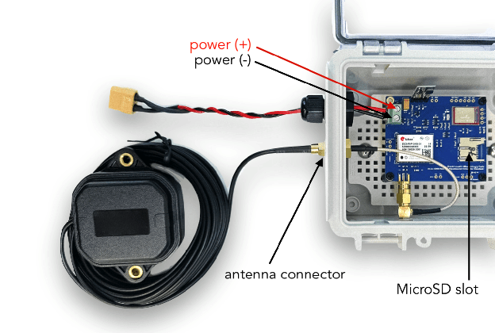
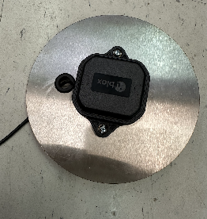
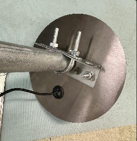
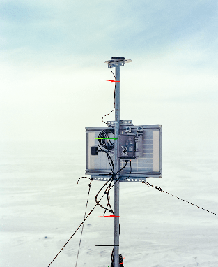
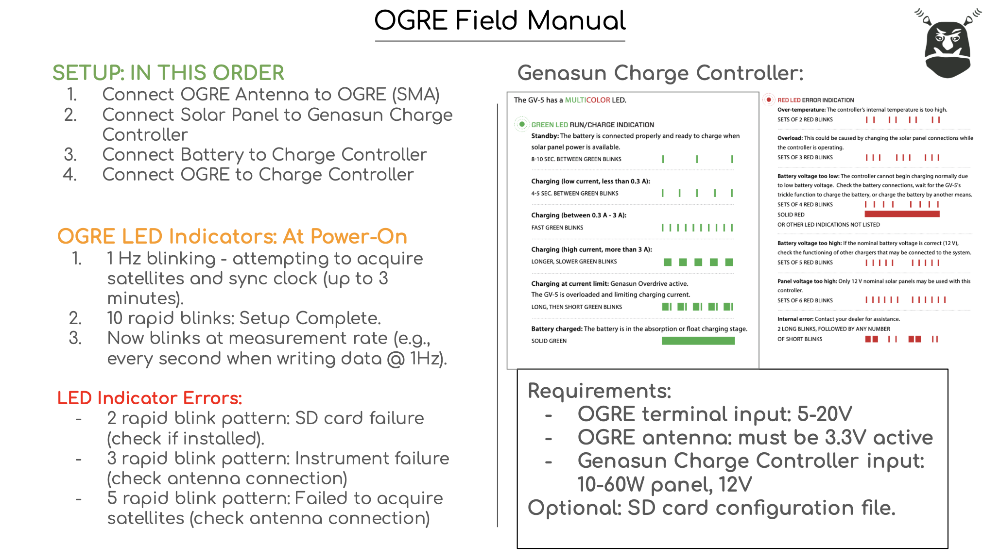

# OGRE User Guide
Updated 19 November 2026 (firmware V3.2.0)

Github project page: [https://github.com/glaciology/ogre](https://github.com/glaciology/ogre)
Landing page: [https://sites.dartmouth.edu/ice/ogre/](https://sites.dartmouth.edu/ice/ogre/)
Questions & contact: [derek@dartmouth.edu](mailto:derek@dartmouth.edu)

## Overview

Originally designed for easy, lightweight, multi-GNSS data logging in remote regions of the Arctic, this instrument incorporates low power, low cost components onto a single circuit board and enables large array deployments with easy fieldwork logistics. We stripped many of the features found on commercially available options that we determined are not needed in polar deployments, reducing cost, weight, and battery consumption.

* Multi-band GNSS: Logs GPS, GLONASS, BEIDOU, GALILEO, QZSS & Satellite Nav Messages to a microSD, which can be easily converted to standard RINEX format for positioning with PPK or PPP, or for GNSS interferometric reflectometry (GNSS-IR).
* Two hardware versions: OGREv1 (SparkFun Artemis module, 1 LED) with a ZED-F9P or ZED-F9T, and OGREv2 (Apollo3 MCU, 2 LEDs) with a ZED-F9P or ZED-X20P.
* Signals: ZED-F9P logs L1/L2. ZED-F9T logs L1/L2 or L1/L5, as configured on the module. ZED-X20P logs L1/L2/L5; L5 is enabled automatically on the X20P only.
* Simple: just plug in an antenna and power. Instrument will immediately start working based on configuration settings.
* Easily configurable: via a configuration file (CONFIG.TXT) on the microSD card. Many customizable options to optimize data and battery needs, such as daily logging during summertime and weekly logging during the winter.
* Low power: ~0.63 W means you save weight and money in batteries. We have used a single 40 A hr battery + 10 W solar panel to log data continuously at 74 degrees North, and for 24-30 hours per week during the polar night.
* Open source: firmware built in Arduino environment and from Sparkfun and Cryologger code.
* Small: PCB inside enclosure measures 7×6.5×2.5 cm.
* Low cost: material cost ~$170.00 USD – you can lose it in a crevasse and not be out of thousands of dollars.

## Contents

- [OGRE Basic Configuration](#ogre-basic-configuration)
  - [Configuring OGRE Settings](#configuring-ogre-settings)
  - [Settings Reference](#settings-reference)
  - [Log Modes](#log-modes)
  - [CONFIG.TXT Rules](#configtxt-rules)
  - [EPOCH.TXT (Log Mode 5)](#epochtxt-log-mode-5)
  - [Firmware Versions & CONFIG.TXT Compatibility](#firmware-versions--configtxt-compatibility)
  - [OGRE Indicator Lights](#ogre-indicator-lights)
  - [Output Files](#output-files)
- [OGRE Hardware Setup](#ogre-hardware-setup)
  - [Hardware Versions](#hardware-versions)
  - [Basic Handling & Precautions](#basic-handling--precautions)
  - [Recommended MicroSD Card Size](#recommended-microsd-card-size)
  - [Recommended Batteries and Battery Setup](#recommended-batteries-and-battery-setup)
  - [Suggestions for Battery Connector](#suggestions-for-battery-connector)
  - [Recommended Antennas and Antenna Setup](#recommended-antennas-and-antenna-setup)
  - [Example Setup with Solar Power, and Suggested Charge Controller](#example-setup-with-solar-power-and-suggested-charge-controller)
- [Data Processing](#data-processing)
  - [Converting raw .ubx data to RINEX](#converting-raw-ubx-data-to-rinex)
  - [Suggestions for processing RINEX](#suggestions-for-processing-rinex)
  - [Antenna Phase Center Considerations](#antenna-phase-center-considerations)
  - [GNSS Interferometric Reflectometry Considerations](#gnss-interferometric-reflectometry-considerations)
- [Advanced Configuration & Usage](#advanced-configuration--usage)
  - [Firmware modification](#firmware-modification)
  - [Firmware upload](#firmware-upload)
  - [Battery modification](#battery-modification)
- [Suggested Compatible Hardware Summary](#suggested-compatible-hardware-summary)
- [Suggested Manufacturing Instructions](#suggested-manufacturing-instructions)
- [Credits](#credits)
- [Quick Guide](#quick-guide)

## OGRE Basic Configuration

### Configuring OGRE Settings

All configuration of settings is done via a text (.txt) file that must be placed on the MicroSD card. **Recommended for all firmware versions:** insert an empty microSD card in the OGRE and power it on. The OGRE writes a CONFIG.TXT with its default settings to the card. This guarantees the file matches the installed firmware. Then edit the values in that file. **Do not change the name of the file**, and make sure to follow the instructions below on modifying the settings. CONFIG.TXT is read only at power-on or reset.

If you change none of the settings, firmware V3.2.0 uses Log Mode 6 (seasonal) with a measurement every 5 seconds, and GPS, GLONASS, Galileo and BeiDou enabled.

**CONFIG.TXT files are not interchangeable between all firmware versions.** Firmware V3.2.0 accepts older CONFIG files (missing settings use their defaults). Firmware V3.0.1 rejects CONFIG files from V3.2.0 and uses its defaults for all settings. See [Firmware Versions & CONFIG.TXT Compatibility](#firmware-versions--configtxt-compatibility).

The CONFIG.TXT file written by firmware V3.2.0 (with default values):

```
LOG_MODE(1: daily hr, 2: cont, 3: mon, 4: 24 roll, 5: date, 6: season, 8: 2x daily)=6
LOG_START_HOUR_UTC(mode 1&8 only)=12
LOG_END_HOUR_UTC(mode 1&8 only)=16
LOG_START_DAY(mode 3 only, 1-28)=8
LOG_EPOCH_SLEEP(modes 4/5 only, seconds)=518400
LED_INDICATORS(0-false, 1-true)=1
MEASURE_BATTERY(0-false, 1-true)=0
ENABLE_GPS(0-false, 1-true)=1
ENABLE_GLO(0-false, 1-true)=1
ENABLE_GAL(0-false, 1-true)=1
ENABLE_BDS(0-false, 1-true)=1
ENABLE_QZSS(0-false, 1-true)=0
ENABLE_NAV_SFRBX(0-false, 1-true)=0
STATION_NAME(0000, char)=0000
MEASURE_RATE(integer seconds)=5
BAT_SHUTDOWN_V(00.0, volts)=10.90
WINTER_INTERVAL(seconds, mode 6 only)=777600
SUMMER_START_MONTH(mode 6 only)=4
SUMMER_END_MONTH(mode 6 only)=9
SUMMER_START_DAY(mode 6 only)=21
SUMMER_END_DAY(mode 6 only)=21
OUTPUT_UART_RAWX=0
LOG_START_HOUR_TWO_UTC(mode 8 only)=16
LOG_END_HOUR_TWO_UTC(mode 8 only)=19
V3.2.0 end;
```

### Settings Reference

Each line item is a specific setting:

| Setting | Valid values | Default | Used by |
|---|---|---|---|
| `LOG_MODE` | 1, 2, 3, 4, 5, 6, 7, 8, 99 | 6 | All |
| `LOG_START_HOUR_UTC` | 0-23 | 12 | Modes 1, 8 |
| `LOG_END_HOUR_UTC` | 0-23 | 16 | Modes 1, 8 |
| `LOG_START_DAY` | 1-28 | 8 | Mode 3 |
| `LOG_EPOCH_SLEEP` | Seconds, ≥1; ≤31536000 (1 year) supported | 518400 (6 days) | Modes 4, 5 |
| `LED_INDICATORS` | 0, 1 | 1 | All |
| `MEASURE_BATTERY` | 0, 1 | 0 | All |
| `ENABLE_GPS` | 0, 1 | 1 | All |
| `ENABLE_GLO` | 0, 1 | 1 | All |
| `ENABLE_GAL` | 0, 1 | 1 | All |
| `ENABLE_BDS` | 0, 1 | 1 | All |
| `ENABLE_QZSS` | 0, 1 | 0 | All |
| `ENABLE_NAV_SFRBX` | 0, 1 | 0 | All |
| `STATION_NAME` | 4 characters, letters and digits only | 0000 | All |
| `MEASURE_RATE` | 1-60 (integer seconds) | 5 | All |
| `BAT_SHUTDOWN_V` | 5.0-16.0 (volts) | 10.9 | `MEASURE_BATTERY=1` |
| `WINTER_INTERVAL` | Seconds, ≥1; ≤31536000 (1 year) supported | 777600 (9 days) | Mode 6 |
| `SUMMER_START_MONTH` | 1-12 | 4 | Mode 6 |
| `SUMMER_END_MONTH` | 1-12 | 9 | Mode 6 |
| `SUMMER_START_DAY` | 1-28 | 21 | Mode 6 |
| `SUMMER_END_DAY` | 1-28 | 21 | Mode 6 |
| `OUTPUT_UART_RAWX` | 0, 1 | 0 | All |
| `LOG_START_HOUR_TWO_UTC` | 0-23 | 16 | Mode 8 |
| `LOG_END_HOUR_TWO_UTC` | 0-23 | 19 | Mode 8 |

**Log Start Hour, Log End Hour UTC [0-23]:** Used if you specify LOG_MODE=1 or LOG_MODE=8. Specify the start and stop hour for the logging interval (the first session of the day in mode 8).

**Log Start Hour 2, Log End Hour 2 UTC [0-23]:** Used if you specify LOG_MODE=8. Specify the start and stop hour for the second logging session of the day.

**Log Start Day [1-28]:** Used if you specify LOG_MODE=3. The range is 1-28, to protect against unexpected behavior for months that do not have a 29th, 30th or 31st day. Data will log for 24 hours on the specified day.

**Log Epoch Sleep [positive integer]:** Used if you specify LOG_MODE=4 or LOG_MODE=5. Number of seconds to sleep between logging sessions, counted from the end of each 24-hour session.

**LED Indicators [0,1]:** Generally recommended to leave LED on, unless you have small battery power margins. If 0, the sleep and logging LEDs are disabled; initialization and error patterns remain.

**Measure Battery [0,1]:** Turn this off if you have the OGRE wired to the load of a charge controller. If turned on, the OGRE measures the battery voltage at the start of each log session and records it in the debug file at the end of each session. If the battery voltage is < BAT_SHUTDOWN_V, the OGRE goes into sleep mode until battery voltage recovers to BAT_SHUTDOWN_V + 0.5 V. Voltage is not monitored during a session.

**Enable GPS/GLO/GAL/BDS/QZSS/NAV [0,1]:** Select each constellation you want to log. If you are planning to process your data with PPP (using final orbits), it is suggested that you turn off NAV because you will use better ephemeris and will save SD card space. On the ZED-X20P, ENABLE_GLO is applied if supported by the module firmware; a rejection is recorded in the debug file as `CFG_FAIL_n`.

**Station Name [4 characters]:** This name is used for each log file, in the format `SSSS_YYYYMMDD_HHMM.ubx`. Use letters and digits only. Names longer than 4 characters are truncated. Characters such as `/ \ : * ? " < > |` and spaces prevent file creation.

**Measure Rate [integer 1-60]:** In seconds. How often data is measured and logged. E.g., put "1" for 1 Hz measurements, "5" for a measurement every 5 seconds.

**Battery Shutdown [00.0]:** Specify a voltage (e.g., 10.9) if using 'Measure Battery' for which the OGRE will go into emergency sleep mode if the battery is nearing depletion.

**Winter interval [positive integer]:** In seconds. How long to sleep after a 24-hour winter session before waking up again to log. E.g., put '518400' (518,400 seconds = 6 days) if you want to log on every 7th day. Use this for Log Mode 6.

**Summer Start/End Month [1-12]:** Use this to define the beginning and end month of Summer for Log Mode 6.

**Summer Start/End Day [1-28]:** Use this to define the beginning and end day of Summer for Log Mode 6.

**Output UART RAWX [0,1]:** If 1, raw UBX data of all logged messages (RAWX, plus SFRBX if enabled) are written to the serial port at 115200 baud, in addition to the uSD card. Debug text is written to the same serial port. Disabled automatically if MEASURE_RATE < 5.

### Log Modes

**Log Modes [1, 2, 3, 4, 5, 6, 7, 8, 99]:** Enter one of the following integers to select the desired log mode:

* (1) Daily Fixed Mode: Log GNSS data at the same UTC time every day, starting at LOG_START_HOUR_UTC and ending at LOG_END_HOUR_UTC.
  * Sessions start and end on the hour (UTC). Windows that cross midnight are supported (e.g., start 22, end 4).
  * Start and end hours must differ.
* (2) Continuous Mode: Log GNSS data continuously (new file generated at each midnight UTC).
  * The RTC is re-synced at each midnight UTC, leaving a gap of a few seconds between files.
  * The system does not sleep in this mode (except for low battery).
* (3) Monthly Mode: Log GNSS data for 24 hours on a USER-specified day (1-28) each month.
  * Sessions start at 00:00 UTC on LOG_START_DAY and last 24 hours from wake-up, ending on the following UTC date.
* (4) Interval Mode: Each 24-hour log session is spaced by a USER-defined interval (e.g., log every 3 days for 24 hours).
  * The sleep interval is counted from the end of each session: one cycle = 24 hours + LOG_EPOCH_SLEEP + RTC sync time.
  * Session start times shift later each cycle by the RTC sync time.
  * Sleep intervals longer than 1 year are not supported.
* (5) Date Mode: Log GNSS data for 24 hours on USER-specified dates/times read from EPOCH.TXT. Defaults to mode 4 after the last user-provided date. This might be useful to time a logging session with satellite overflights.
  * Dates must be listed in ascending order.
  * Each date starts a 24-hour session; a date that falls within a running session is skipped.
  * Dates more than 1 year in the future are not supported.
  * If EPOCH.TXT is missing or invalid, mode 4 behavior is used from the start.
* (6) Polar optimized (seasonal) mode: During summer, log continuously (new file each midnight UTC). During winter, log once for 24 hours, then sleep for WINTER_INTERVAL seconds. The USER defines the summer dates. E.g., if in Antarctica, you might define summer as October 15 to February 28, during which data is logged continuously.
  * Summer runs from SUMMER_START_MONTH/SUMMER_START_DAY through SUMMER_END_MONTH/SUMMER_END_DAY, inclusive (default April 21 - September 21).
  * Summers that wrap the new year (start month > end month, e.g., southern hemisphere) are supported.
  * Summer start and end days are limited to 1-28.
  * The winter sleep interval is counted from the end of each session. If summer begins during a winter sleep, the system wakes at the start of summer.
* (7) Reserved for development. Not for deployment.
* (8) Twice-Daily Mode: Log GNSS data twice a day, to capture diurnal changes: from LOG_START_HOUR_UTC to LOG_END_HOUR_UTC and from LOG_START_HOUR_TWO_UTC to LOG_END_HOUR_TWO_UTC.
  * Both sessions must fall within one UTC day, in chronological order, without touching (end of session 1 < start of session 2). Sessions crossing midnight are not supported.
  * Available in firmware V3.2.0 and later.
* (99) Test Mode: Used for development. Log GNSS data for 50 seconds, sleep for 50 seconds, and repeat.

All modes:

* Each session begins with an RTC sync, which requires a 3D fix with confirmed date and time. Logging begins once the sync completes (up to 3 minutes after wake-up).
* All times are UTC.
* Modes 1, 3 and 8: if the system powers on outside a log window, it writes a short .ubx file and a debug line, then sleeps until the next window. This confirms the system initialized.

### CONFIG.TXT Rules

Firmware V3.2.0:

* Each line has the form `SETTING(description)=value`. The text in parentheses is ignored and may be omitted.
* Settings are matched by name; line order does not matter.
* Setting names are case-sensitive. No spaces before `(` or `=`.
* Lines are limited to 99 characters.
* Lines without `=` (e.g., the version line) and blank lines are ignored.
* A missing or invalid setting keeps its default value. Missing, invalid and unrecognized settings are recorded in the debug file as `CFG_FILE_ERROR`. There is no LED indication.
* If a setting appears more than once, the last value is used.
* Values are read as integers (except `BAT_SHUTDOWN_V` and `STATION_NAME`). Reading stops at the first non-digit: `86,400` is read as 86. Non-numeric text is read as 0, which is a valid value (disabled) for 0/1 settings.
* Save as plain text (ANSI or UTF-8 without BOM). A UTF-8 BOM causes the first line (`LOG_MODE`) to be ignored. On macOS TextEdit, use Format > Make Plain Text.
* The file must be named `CONFIG.TXT` (not case-sensitive). On Windows, check that the file is not saved as `CONFIG.txt.txt`.
* Windows and Mac line endings are supported.

### EPOCH.TXT (Log Mode 5)

* Exactly 20 lines, each `label=unix_epoch` (e.g., `1=1656348647`). Unused lines are set to `0`.
* A file with any other number of lines (including a trailing blank line) is ignored: the instrument blinks 5 times and uses mode 4 behavior.
* Read only when `LOG_MODE=5`.

### Firmware Versions & CONFIG.TXT Compatibility

| | V3.0.1 | V3.2.0 |
|---|---|---|
| Hardware supported | v1 only | v1 and v2 |
| GNSS modules | ZED-F9P, ZED-F9T | ZED-F9P, ZED-F9T, ZED-X20P |
| CONFIG.TXT lines | Exactly 22 (21 settings + version line) | Any; matched by name |
| Settings read by | Line position | Setting name |
| Log modes | 1-7, 99 | 1-8, 99 |
| `OUTPUT_UART_RAWX`, `LOG_START_HOUR_TWO_UTC`, `LOG_END_HOUR_TWO_UTC` | Not available | Available |
| Range checks | `LOG_MODE`, 0/1 settings, `MEASURE_RATE` ≥1 only | All settings |
| L5 | Set at compile time | Automatic (ZED-X20P only) |
| Default `LOG_MODE` | 2 | 6 |

V3.0.1 limitations:

* A CONFIG.TXT with any number of lines other than 22 (including a trailing blank line) is rejected entirely: all settings use defaults, the instrument blinks 6 times, and `CFG_FILE_VERSION` is recorded in the debug file.
* Settings are read by position: lines must be in the V3.0.1 order. The setting names are not checked, except `STATION_NAME(0000, char)` and `BAT_SHUTDOWN_V(00.0, volts)`, which must match exactly (including the text in parentheses) or the default is used.
* No range checks on `LOG_START_HOUR_UTC`, `LOG_END_HOUR_UTC`, `LOG_START_DAY`, `LOG_EPOCH_SLEEP`, `WINTER_INTERVAL`, or the `SUMMER_` settings. Out-of-range values are used as entered.
* Mode 1: at power-on, logs from power-on until `LOG_END_HOUR_UTC`, regardless of the start hour.
* Mode 3: at power-on, logs 24 hours from power-on, regardless of the day.
* A rejected constellation setting halts the instrument (3 blink pattern) until watchdog reset.

Compatibility:

* V3.0.1 CONFIG.TXT on V3.2.0: accepted. `OUTPUT_UART_RAWX`, `LOG_START_HOUR_TWO_UTC` and `LOG_END_HOUR_TWO_UTC` use defaults, and `CFG_FILE_ERROR` is recorded in the debug file. Values outside the V3.2.0 ranges use defaults.
* V3.2.0 CONFIG.TXT on V3.0.1: rejected (25 lines). All settings use V3.0.1 defaults.

### OGRE Indicator Lights

OGREv1 has a single status light; all patterns appear on that LED. OGREv2 has two lights (red and yellow), with the same blink patterns; the colors distinguish errors (red) from normal start-up indicators (yellow). At the end of the day, if the OGRE is properly powered and logging data, you will see rapid blinks while it writes data. To conserve as much power as possible, the LED is dim. This will require you to look closely at the LED, next to the MicroSD card slot, on a sunny day.

Insert the uSD card (with or without CONFIG & EPOCH files), then connect the battery to +/- sides of the screw terminal. The system will attempt to initialize and the following LED indicators will flash:

* 1 Hz Blinks: System acquiring GPS time and attempting to sync real time clock (RTC). Up to 3 minutes. **-    -    -    -    -    -    -    -    -    - . . . up to 3 minutes.**
* 10 Rapid Blinks: System Configuration Complete! **-  -  -  -  -  -  -  -  -  -**

The following indicate failure of initialization:

* 2 Blink Repeating Pattern: uSD initialization failed (is the SD card seated properly?) - system awaiting automatic reset to try again (about 1.5 minutes). **-   -   \      -   -    \     -   - \  . . . .**
* 3 Blink Repeating Pattern: GNSS module not detected (is the antenna properly connected?), or GNSS data file could not be created (check STATION_NAME and the SD card) - system awaiting automatic reset to try again (about 1.5 minutes). **-   -   -   \       -   -   -     \     -   -   -  \  . . .**
* 5 Blink Repeating Pattern: RTC failed to sync with GNSS time within 3 minutes (are you outside?) - system awaiting automatic reset to try again (about 1.5 minutes). **-   -   -   -   -  \       -   -   -   -   -   \ . .**
* 5 Rapid Blinks, once: EPOCH.TXT missing or wrong number of lines (mode 5 only).
* 6 Rapid Blinks, once: CONFIG.TXT missing - using defaults; a default CONFIG.TXT is written to the card.

After an RTC sync failure, the system restarts and retries until a fix is obtained. The system does not sleep and draws full power during retries. The battery shutdown threshold is not applied during retries.

Once the system is initialized, it will either sleep or begin logging data, depending on the specified log mode. If the USER has enabled LED_INDICATORS, the following additional lights will flash:

* Rapid, irregular flashes (faint): System logging GNSS data; one flash per 512-byte write to the SD card.
* 1 Blink (bright) every 12 seconds: System in sleep mode.

No blinks: system is in deep sleep due to low battery, LED_INDICATORS=0, or system is dead due to dead battery.

| Pattern | Meaning | Color (v2) |
|---|---|---|
| 2 blink pattern, repeating | microSD card failed to initialize (twice) | Red |
| 3 blink pattern, repeating | GNSS module not detected on I2C, or GNSS data file could not be created | Red |
| 5 blink pattern, repeating | RTC failed to sync with GNSS within 3 minutes | Red |
| 5 rapid blinks, once | EPOCH.TXT missing or wrong number of lines (mode 5 only) | Red |
| 6 rapid blinks, once | CONFIG.TXT missing — using defaults; default CONFIG.TXT written | Red |
| 10 blinks | RTC synced + system configuration complete (power-on/reset only) | Yellow |
| 1 blink, roughly every 12 seconds | Device sleeping between sessions (`LED_INDICATORS=1`) | Yellow |
| 1 Hz blink | Acquiring GNSS fix during RTC sync | Yellow |
| Rapid, irregular blinks while active | Logging; one blink per 512-byte write to SD (`LED_INDICATORS=1`) | Yellow |
| No blinks at all | Deep sleep — battery below shutdown threshold, or `LED_INDICATORS=0` | None |

### Output Files

GNSS data files:

* Named `SSSS_YYYYMMDD_HHMM.ubx`, where `SSSS` is `STATION_NAME` and `YYYYMMDD_HHMM` is the UTC session start time. All files are written to the root of the uSD card.
* Contain UBX-RXM-RAWX at `MEASURE_RATE`, plus UBX-RXM-SFRBX if `ENABLE_NAV_SFRBX=1`.
* Two sessions starting in the same minute are written to the same file.
* Data are saved to the card every 5 seconds; a power loss can lose up to the last 5 seconds of data.
* RAWX epochs with more than 120 measurements are not logged (SparkFun u-blox GNSS v3.1.15 limit).

Debug file:

* Named `debug_<chipID>.csv`, where `<chipID>` is the MCU's unique ID in hex. One file per instrument, independent of `STATION_NAME`.
* A header line is appended at every power-on or reset. It contains the software version, the column names, and the reset cause (e.g., `POIRSTAT` power-on, `WDRSTAT` watchdog reset).
* A data line is appended at the end of each log session and at each error.
* Columns: date/time, debugCounter, onlineGNSS, onlineSD, rtcSync, rtcDrift (seconds corrected at the last RTC sync), bytesWritten, maxBufferBytes, wdtCounterMax, writeFailCounter, syncFailCounter, closeFailCounter, LogMode, errorCode, lowBattery, Temperature (MCU, °C), Battery (V, only if `MEASURE_BATTERY=1`).
* Date/time on lines written before the first RTC sync after power-on is not valid.

| errorCode | Meaning |
|---|---|
| `success` | Log session completed |
| `GNSS_<module>_<fw>_<version>_L2=_L5=_setL5=` | Once per power-on: detected GNSS module, firmware, the L2/L5 state at power-on, and whether L5 was enabled by the OGRE |
| `GNSS_ID_FAIL_...` | GNSS module could not be identified; L5 not enabled |
| `CFG_FILE_ERROR` | CONFIG.TXT has missing, invalid or unrecognized settings; defaults used for those settings |
| `CFG_FAIL_n` | `n` constellation settings were rejected by the GNSS module |
| `I2C` | GNSS module not detected |
| `RTC_SYNC` | RTC sync failed within 3 minutes |
| `GNSS_FILE_CREATE` | GNSS data file could not be created |

## OGRE Hardware Setup

There are three interfaces on the OGRE: the power connector, the antenna connector, and the MicroSD slot. For choosing the correct MicroSD card, see the [Recommended MicroSD Card Size](#recommended-microsd-card-size) section below. For details on what battery to choose and how to connect the OGRE, see [Recommended Batteries and Battery Setup](#recommended-batteries-and-battery-setup). For attaching the antenna and/or selecting an antenna, see [Recommended Antennas and Antenna Setup](#recommended-antennas-and-antenna-setup).


[Figure 1] Diagram of the three interfaces: power the OGRE with a positive and negative connection, insert a MicroSD card with the CONFIG.TXT file, and attach the antenna.

### Hardware Versions

| | OGREv1 | OGREv2 |
|---|---|---|
| MCU | SparkFun Artemis module (Apollo3) | Ambiq Apollo3 |
| LEDs | 1 | 2 (red, yellow) |
| GNSS module | ZED-F9P, ZED-F9T | ZED-F9P, ZED-X20P |
| Bootloader | SVL (installed on Artemis modules) | None by default (SWD/JTAG upload) |
| Firmware | All versions | V3.2.0 and later |

### Basic Handling & Precautions

Like any electronics, the OGRE is susceptible to damage from dust, water, and/or electric shock. When opening the OGRE enclosure, take care to insert or remove the MicroSD card in sheltered conditions away from blowing snow or rain. Polar regions are often very dry and it is possible to shock the electronics by touching it, without feeling a shock yourself.

**Note:** the enclosure provided has been tested in the dry snow zone in Greenland. We have noticed that in warmer, wetter climates, water can condense on the interior lid, and/or the connectors can permit water entry if not tightened correctly. For installations in difficult environments, we suggest placing the OGRE inside your larger battery enclosure, including desiccants, and/or adding additional shielding for the antenna and power connectors.

Antenna: the antenna is an active, powered signal line at 3.3 volts. This means damage can occur to the instrument if the antenna is attached to the instrument when water or snow has contaminated the threaded SMA connector, shorting the instrument. Always ensure that there is no damage to the antenna or water intrusion at the SMA connection point prior to installation.

### Recommended MicroSD Card Size

Under clear sky conditions and tracking all major constellations (GPS, GLONASS, BEIDOU, GALILEO) with a ZED-F9P, the following data rates apply at 1 Hz logging interval:

| Logging Continuously, 1 year | Total Data Volume (GB) | Daily File Size (MB) |
| :---: | :---: | :---: |
| All Constellations L1/L2 @ 1Hz | 85 | 232 MB |
| GPS L1/L2 Only @ 1Hz | 23 | 63 MB |

ZED-X20P files are larger, because L5 signals are logged in addition to L1/L2.

Use this table to estimate the required storage size of your MicroSD card. For example, if you instead log data continuously at an interval of once every 5 seconds instead of once every 1 second (1 Hz), then you can expect to generate 85 GB / 5 = 17 GB of data over the course of a year, tracking all constellations. Thus, a 32 GB MicroSD card is appropriate, assuming you retrieve the data after no more than 1.8 years.

The uSD card's free space is not checked. If the MicroSD card fills up, no new data will be written; failed writes are counted in `writeFailCounter` in the debug file.

As another example, if you are using Log Mode 6 and deploying your station for 5 years, logging data continuously during the summer (May - September) at 5 second rate, and once every 10 days in the winter at 5 second rate for 24 hours, then your data volume calculation will be as follows:

Summer: 5 months * 31 days * .232 GB / **5** = 7.2 GB
Winter: 7 months * 31 days / 10 days * .232 GB / **5** = 1 GB

Thus, your annual data storage is just 8.2 GB. A 16 GB MicroSD card can therefore store about 2 years of data before retrieval. Take care in selecting a genuine microSD card from a reputable manufacturer. We have noticed no difference in performance between "industrial" microSD cards rated to -40 C and "consumer" cards rated for -16 C.

### Recommended Batteries and Battery Setup

Any DC power supply between 5.2 V and 20 V is readily suitable for the OGRE without any modifications required. Be sure to decide whether you want the OGRE Battery Monitor turned on (see CONFIG.TXT file) to record battery voltage and shut down the device if voltage drops below the USER specified voltage (e.g., 10.8 V for our 12 V Deka 8G-40 lead acid batteries). If the voltage measured at the start of a session is below 10.8 V, the OGRE will enter sleep mode until voltage reaches 10.8 V + 0.5 V.

*Important: If you choose to attach the OGRE to a solar charge controller instead of directly to the battery, this battery monitor should be turned off.*

To connect the battery to the OGRE, there are many options depending on your setup. 12-18 AWG wire can be attached to the battery terminals and the OGRE terminal. Make sure the wiring sheath is rated for the cold to prevent cracking. We integrate XT60 connectors to allow for easy power up/power down of the OGRE in the field, although these are not waterproof if outside.

When running the OGRE on a 12 V battery, the following power consumption was measured:

| | Awake & Logging | Asleep |
| :---: | :---: | :---: |
| Observed Power (12V) | 0.62 - 0.67 W | 0.0009 W |

To calculate how long the OGRE will last (assuming no solar panel) in Awake & Logging data mode, take the voltage and the Amp Hour specifications from your battery and calculate:

Battery Voltage * Amp Hour Capacity / 0.667 W = X Hours of run time.

For example, we use a 12 V, 48 Amp Hour battery: 12 V * 48 Amp Hour = 576 Watt Hours. 576 Watt Hours / 0.67 Watts = 863 hours (or 36 days).

This is a simple calculation and does not take into account the loss of battery capacity in the cold. In extreme cases, battery capacity can be reduced to < 5% in cold temperatures [see Earthscope study on battery capacity in the cold [here](https://kb.unavco.org/article/sla-battery-cold-performance-tests-gel-vs-agm-386.html)]. If you are using a log mode that involves a lot of sleeping (e.g., logging once for 24 hours, once a week), then you will also want to factor in the asleep power consumption into your calculations.

Anecdotally, we have run an OGRE for 3 hours a day (Log Mode 1), every day throughout the polar night successfully at 72º N and 3000 m elevation, with a single 12 V 48 Amp Hr battery. Similarly, we have run an OGRE for 24 hour logging sessions once every week through the polar winter on the same battery.

In the summer time with 24 hour sunlight, we have run an OGRE off of a 10 W solar panel and a smaller, 7 Amp Hr battery, continuously. A 10 W solar panel, at 10% capacity, is still more than enough power for the OGRE, and the small battery can power the OGRE up to 5 days during cloudy conditions.

We recommend the Genasun GV- line of charge controllers if you use a solar panel, as they are very low power. Most market charge controllers are overkill and/or not optimized for low power applications. A polar-specific paper on charge controller selection can be found [here](https://gi.copernicus.org/articles/14/503/2025/gi-14-503-2025.pdf).

### Suggestions for Battery Connector

To connect the battery to the instrument, the components shown in Figure 1 include 18 gauge AWG wire soldered to an XT60 connector for easy power on/power off.

### Recommended Antennas and Antenna Setup

We provide you with the u-blox ANN-MB L1+L2 patch [antenna](https://content.u-blox.com/sites/default/files/documents/ANN-MB_DataSheet_UBX-18049862.pdf). This antenna requires a ground plane for nominal performance (any metal disc with a diameter of 12+cm will do). Furthermore, we note that this antenna does not have phase center corrections, thus you can only expect cm-level precision in your position analysis (see datasheet for estimated phase center offsets and corrections). To log L5 with a ZED-X20P (or an L1/L5 ZED-F9T), use an antenna that covers L5 (e.g., an L1/L2/L5 antenna).

For most glacier or ground displacement analyses or GNSS interferometric reflectometry, this is not an issue. However, if you require a calibrated antenna, any active, 3.3 V calibrated antenna will suffice. Sparkfun sells a relatively low cost calibrated antenna [here](https://www.sparkfun.com/gnss-multi-band-l1-l2-surveying-antenna-tnc-top106.html). Note that the OGRE does not detect or record the antenna model, so the antenna calibration parameters must be manually added to the RINEX header prior to PPK or PPP processing. Remember, this is an active antenna! Water intrusion at the SMA connection interface or damage to the cable can short the instrument, so take care to ensure that the antenna is installed carefully.

 
[Figure 2] Antenna example attachment to ground plane and to conduit that serves as antenna mast.

### Example Setup with Solar Power, and Suggested Charge Controller



[Figure 3] In the dry snow zone, we are not worried about liquid water intrusion. The OGRE is mounted externally on the backside of a 10 W solar panel as shown above for easy access to the MicroSD card, given that the pole will slowly become buried. The OGRE is powered by a 12 V 48 Amp Hr battery and a Genasun GV-5 charge controller (made in lead acid and lithium versions–low power).

## Data Processing

### Converting raw .ubx data to RINEX

Data is recorded in proprietary u-blox format [.ubx]. There are several options for converting .ubx into standard RINEX formatted observation and navigation files.

1. Option 1. **RTKLIB** is an open source package for all things GNSS. These are command line tools (with a GUI option for Windows). If you would rather work with a simple desktop application, stop here and jump to Option 2. For **RTKLIB**, I recommend the RTKLIB Explorer fork, which is optimized for ublox GNSS chips. You can find the code [here](https://github.com/rtklibexplorer/RTKLIB/releases). Additional details and a plethora of articles on data processing can be found at the RTKLIB Explorer landing page [here](https://rtklibexplorer.wordpress.com/rtklib-code/).

   Once you have RTKLIB compiled, you will use convbin to convert your .ubx into RINEX, e.g.: `./convbin -r ubx $filename -v 2.11 -os`. Refer to the documentation for a full description of all the conversion options.

2. Option 2. Emlid offers **Emlid Studio** for free: it's built on RTKLIB and can convert .ubx to RINEX, in addition to performing PPK, RTK, and static positioning. Download for Mac or Windows [here](https://emlid.com/emlid-studio/).

### Suggestions for processing RINEX

Any online PPP service (e.g., CSRS-PPP or JPL PPP) is a good starting point for retrieving positions from RINEX files. Some of these services may require a priori position estimates in the RINEX header. Depending on your .ubx to RINEX conversion method, this may not be automatically included in the RINEX header. Consult RINEX standards to see how to insert an estimated position in the header. An example header including the APPROX POSITION XYZ field is provided below.

```
     2.11           OBSERVATION DATA    M: Mixed            RINEX VERSION / TYPE
CONVBIN demo5 b34j                      20251016 030445 UTC PGM / RUN BY / DATE
format: u-blox UBX                                          COMMENT
                                                            COMMENT
                                                            MARKER NAME
                                                            MARKER NUMBER
                                                            OBSERVER / AGENCY
                                                            REC # / TYPE / VERS
                                                            ANT # / TYPE
  1537162.1331 -1637214.1145  5951720.9920                  APPROX POSITION XYZ
        0.0000        0.0000        0.0000                  ANTENNA: DELTA H/E/N
     1     1                                                WAVELENGTH FACT L1/2
     9    C1    L1    S1    C2    L2    S2    C7    L7    S7# / TYPES OF OBSERV
  2025    02    28    00    09   21.9970000     GPS         TIME OF FIRST OBS
  2025    03    01    00    09   17.0120000     GPS         TIME OF LAST OBS
                                                            END OF HEADER
```

You would modify the `ANT # / TYPE` line and populate it with the antenna ANTEX header. `APPROX POSITION`is required for some processing, but sometimes isn't automatically populated by some versions of .ubx to RINEX converters. Reach out to me if you need a script that automatically inserts this into your rinex files. 

### Antenna Phase Center Considerations

Likewise, no antenna information will be present. If you are using a calibrated antenna (not included), you will need to manually add the ANT # / TYPE in the RINEX header. I have batch scripts to automatically do this if you have many data files and know the ANTEX code for your antenna.

### GNSS Interferometric Reflectometry Considerations

OGREs + ublox ANN-MB antennas make for great GNSS-IR stations. If you are interested in any processing strategies or optimizing your data collection for the [gnssrefl](https://gnssrefl.readthedocs.io/en/latest/) GNSS-IR platform, please reach out to me. The RINEX files generated from the OGREs are easily ingested into the *gnssrefl* processing pipeline, although they may require some renaming to match the conventions required by gnssrefl.

## Advanced Configuration & Usage

### Firmware modification

The firmware is available at [github.com/glaciology/ogre](http://github.com/glaciology/ogre). There, you can find instructions to compile the code yourself, submit bugs, and ask software related questions. We encourage any modifications to the firmware to better adapt to your project needs, and instructions on uploading or upgrading the firmware can be found below.

Compile the source code with the Arduino IDE, using the versions defined in the header of OGRE.ino:

* SparkFun Apollo3 Arduino Core v1.2.3
* SdFat library v2.1.0
* SparkFun u-blox GNSS v3 library, v3.1.15 or later (both hardware versions)

Set the `HARDWARE_VERSION` macro in OGRE.ino before compiling: `1` = OGREv1, `2` = OGREv2. `HARDWARE_VERSION` selects the pin assignments and LEDs. GNSS module-specific settings (L5) are detected at run time. The linker start address (0x10000 or 0xC000) must match the target bootloader.

### Firmware upload

Only do this if you want to update the firmware on the OGRE, or if the OGRE has not yet had the firmware installed. Pre-compiled binary files are available with each release (see [releases](https://github.com/glaciology/OGRE/releases/) on Github).

Binaries differ by hardware version and by start address. Use the binary that matches both your board and its bootloader:

| Board | Bootloader on MCU | Binary start address | Upload method |
|---|---|---|---|
| OGREv1 (Artemis module) | SparkFun Variable Loader (SVL), installed on Artemis modules | 0x10000 | USB-to-Serial, `svl.py` |
| OGREv2 (Apollo3), newly manufactured | None (Ambiq secure bootloader only) | 0xC000 | SWD/JTAG |
| OGREv2 (Apollo3) | SVL installed | 0x10000 | USB-to-Serial, `svl.py` |

* A 0x10000 binary does not run on an MCU without the SVL.
* Writing a 0xC000 binary over SWD/JTAG overwrites the SVL. Subsequent uploads require SWD/JTAG.
* A v1 binary on a v2 board (or a v2 binary on a v1 board) uses the wrong pin assignments; the instrument does not operate.

Step-by-step instructions for both methods (USB-to-Serial with the SparkFun bootloader, or SWD with a SEGGER J-Link), including how to install the SparkFun bootloader on an OGREv2, are in the [OGRE Firmware Upload Guide](OGRE_Firmware_Upload_Guide.md). A newly manufactured OGREv2 can only be programmed over SWD/JTAG. If ordering from a manufacturer, you can ask them to upload the .bin firmware using their JTAG/SWD interface (see [Suggested Manufacturing Instructions](#suggested-manufacturing-instructions)).

### Battery modification

The DC-DC converter minimum input is 5.2V and maximum input is 50V, although additional power filtering at high voltages is required.

The Battery Measurement circuit features a voltage divider circuit that must scale max voltage to the ADC input range (0-2.0V). Standard dividers for a 12V battery use 68kOhm and 10kOhm resistors; with the default gain/offset, readings saturate at ~17.4V. USER must adjust the gain/offset of ADC battery measurement conversion in software if using a different power configuration (i.e., different resistor dividers and/or a non-12V battery).

The reverse polarity protection MOSFET has a limit of 20V. Do not exceed 20V without either removing this part or finding an appropriate substitute component.

## Suggested Compatible Hardware Summary

The following items are suggested and/or field-tested companion components.

### Enclosures

- Outdoor: [**WH-02-03**](https://www.polycase.com/wh-02#WH-02-03): clear, hinged plastic case small that can fit OGRE + small Li-ion battery. Often ordered together with ABS [WH-02K](https://www.polycase.com/wh-02k#WH-02K-01) panel for mounting PCB. Supports flanges for external mounting, and we have had luck deploying these in dry glacial regions with no water ingress. *However, moisture will condense inside the lid in wet conditions.*
  - For a pre-drilled case (comes with hole for power connector and antenna), you can order directly here: [https://www.polycase.com/wh-02](https://www.polycase.com/wh-02)
    - The power cable hole will require a PG7 cable gland, e.g. [this](https://www.digikey.com/en/products/detail/essentra-components/CG-PG7-1-BK/3811768) one.
    - The SMA antenna cable hole requires a SMA male to female bulkhead adapter, we use [this](https://www.digikey.com/en/products/detail/gct/CABLE-305-RF-0100-A-1/15648548) one.
    - We use [M2.5](https://www.amazon.com/dp/B07KM5B3PT?ref=ppx_yo2ov_dt_b_fed_asin_title) standoffs to screw in the PCB to the WH-02K panel.
    - Mounting hardware: this is for you to figure out for your particular setup! See example photos above for how this case is attached to the solar panel.
- Even more streamlined outdoor use: Pelican Micro 1010. You are on your own for figuring out how to drill holes etc on this one, but this case will fit an OGRE and we have used them in Greenland.
- For some protection: if you are not directly mounting/using the OGRE somewhere outside, and instead throwing it inside a larger enclosure with other components, you can 3D print an enclosure. See our Github .stl file: [https://github.com/glaciology/OGRE/blob/main/Hardware/Enclosure.stl](https://github.com/glaciology/OGRE/blob/main/Hardware/Enclosure.stl)

### Antennas

- [ANN-MB-00](https://www.digikey.com/en/products/detail/u-blox/ANN-MB-00/9817928): low cost, L1/L2, all constellations, no phase center ANTEX corrections, requires ground plane. The cable is 5 m long, which can be annoying.
  - Ground plane required (!!): any 15 cm metal disc of any thickness will do. If you want pre-drilled holes and to order in bulk, you can order [these](https://www.pcbway.com/project/shareproject/Ground_Plane_for_ublox_L1_L2_L5_GNSS_antenna_c3519487.html). These are made out of PCB material and therefore may tarnish and warp in extreme environmental conditions.
  - If you run into stocking issues with ANN-MB-00, you can often find the antenna re-branded on Sparkfun, Adafruit, and Mouser. Just make sure to get the version that has L1 AND L2 frequencies (not L1/L5, but L1/L2/L5 is ok), and an SMA connector. For L5 logging with a ZED-X20P, use the L1/L2/L5 version.
  - See [this](#recommended-antennas-and-antenna-setup) section for example of how to attach this antenna ground plane to a pole.
- [Calibrated](https://www.sparkfun.com/gnss-multi-band-l1-l2-surveying-antenna-tnc-top106.html) low cost antenna: Sparkfun sells a couple calibrated but still relatively low cost antennas. These will require an RF cable and TNC to SMA adapter.
- Helical antenna: we are actively experimenting with these. More info soon.

### Solar/Power

- We use the 10W Ameresco 10M solar panel for long term, robust deployments. But any panel per your needs will do.
- This is paired with the [Genasun GV-5](https://www.google.com/search?client=safari&rls=en&q=genasun+gv-5&ie=UTF-8&oe=UTF-8) charge controller (for 10 W panels). These are the best charge controllers for low power devices on the market (as of 2025) as they have very little power draw.
- Battery: brands like Powersonic and Deka (lead acid) are reliable and have well documented power capacity curves for the cold. For RTK/surveying applications, we use 4 AA batteries in series… more on this soon.

### microSD

- We mostly stick to Sandisk out of habit, and have not observed any performance issues between buying more expensive industrial/cold-hardened SD cards vs generic. However, try to stay away from knockoffs… they are everywhere.

## Suggested Manufacturing Instructions

This section is being built out–please reach out with questions. Ordering from a contract manufacturer is not like ordering from Amazon. They often will have questions about whether individual components can be substituted (e.g., if the original is out of stock). You will likely pay tariffs on import as well.

Some important things to consider:

- Duds: expect a 5-15% dud rate.
- Pololu power converter: Chinese manufacturers have issues sourcing this component. If this is still the case, you will have to purchase it yourself and through-hole solder it. It's relatively easy!
- Programming: if ordering OGREv2, you must request that the manufacturer upload the OGRE firmware on your behalf (the 0xC000 binary, via SWD/JTAG), unless you own your own SWD/J-Link/JTAG interface. Give the manufacturer the [OGRE Firmware Upload Guide](OGRE_Firmware_Upload_Guide.md) (Option B) with the binary.
  - Programming instructions are also provided on the OGREv2 Landing Page below, along with the bill of materials.

[OGRE v2 (Apollo3, 2 LEDs; ZED-X20P, L1/L2/L5)](https://www.pcbway.com/project/shareproject/OGRE_Open_GNSS_Research_Equipment_v2_0_82247d12.html)

[OGRE v1 (Artemis module, 1 LED; ZED-F9P, L1/L2)](https://www.pcbway.com/project/shareproject/OGRE_Open_GNSS_Research_Equipment_Receiver_33a809f3.html)

[OGRE Antenna Ground Plane (L1/L2/L5)](https://www.pcbway.com/project/shareproject/Ground_Plane_for_ublox_L1_L2_L5_GNSS_antenna_c3519487.html)

## Credits

See the [License](https://github.com/glaciology/OGRE/blob/main/LICENSE.md) page on Github for hardware and software details. The TLDR is that everything is open source. Special acknowledgements on the firmware side go to the [Sparkfun](https://github.com/sparkfun/SparkFun_u-blox_GNSS_v3) ZED-F9P/ublox and [Cryologger](https://github.com/cryologger) projects for developing much of the open source framework and libraries that this hardware relies on.

The OGRE project was funded by a National Science Foundation Office of Polar Programs grant (NSF-OPP 2028421). Free OGRE instrumentation comes from the Evans Family Changing Polar Regions Cluster funding at Dartmouth College.


## Quick Guide

This is a quick guide that may be handy to have on hand in the field, (assuming you are using a Genasun GV-5 charge controller).


